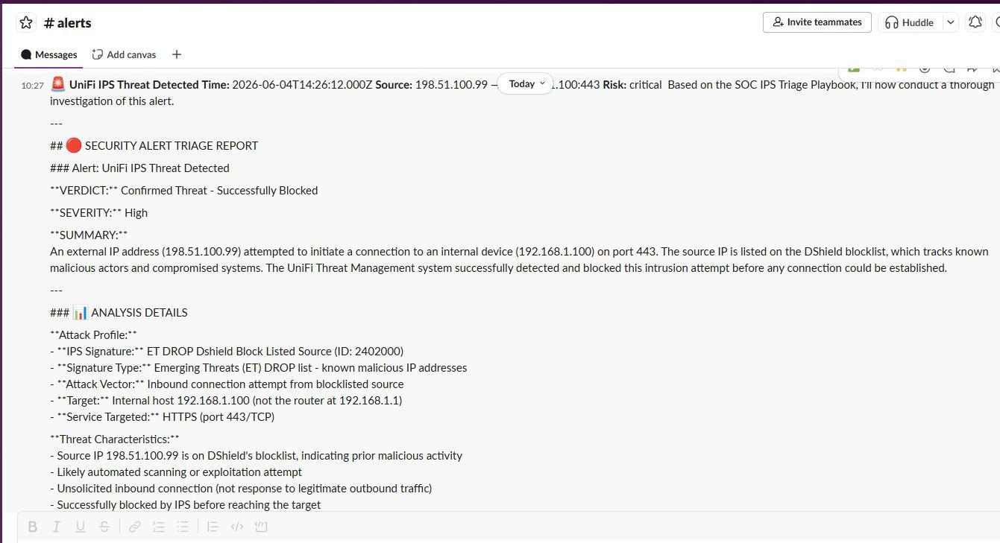
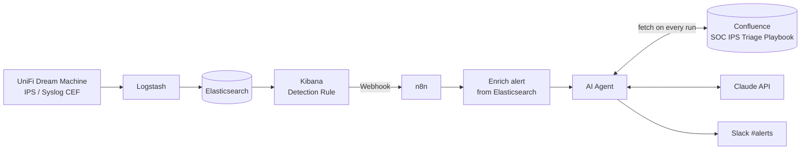
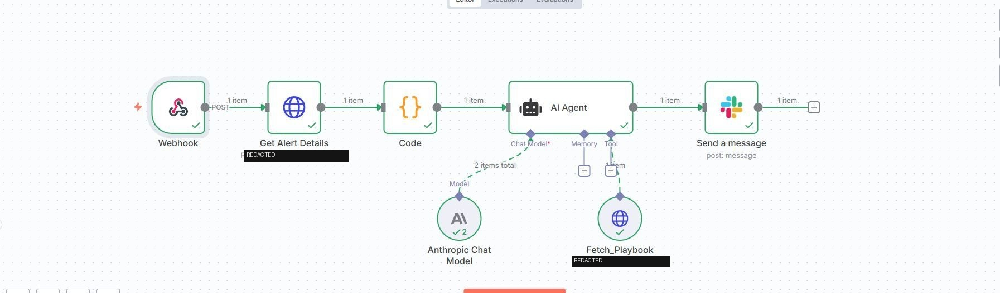
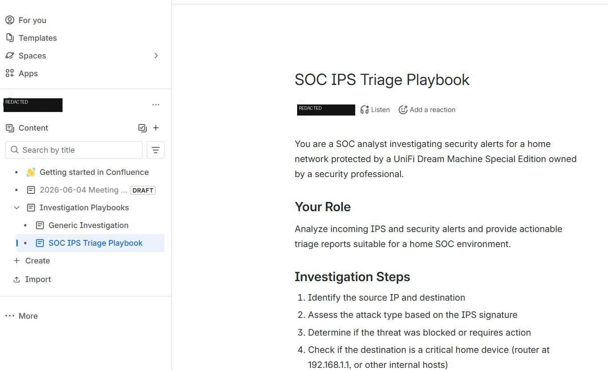
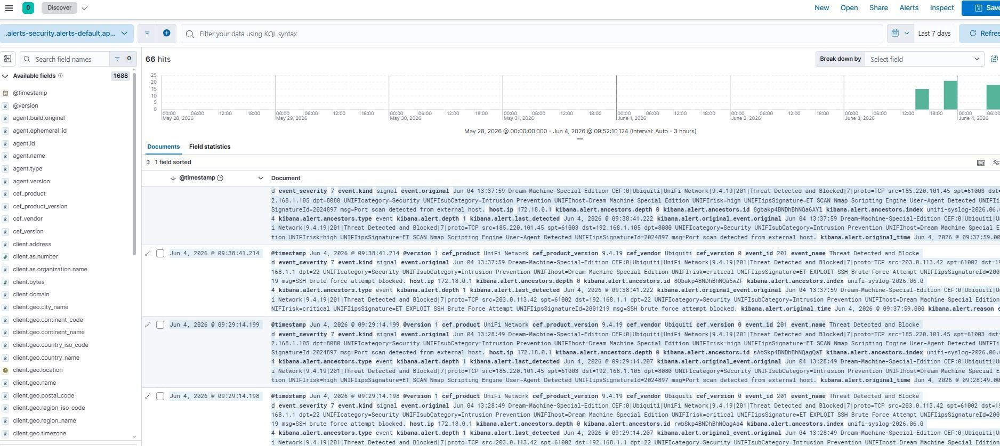

# 🛡️ Home AI SOC — Playbook-Driven Alert Triage

> An AI-powered Security Operations Center for a home network, built in a single day.
> Every IPS alert is investigated by an AI agent that reads a **living playbook from Confluence** before it renders a verdict — and the result lands in Slack in under 60 seconds.



---

## The idea

Most "AI for security" demos hardcode a prompt and call it a day. This project flips that: the investigation procedure lives in **Confluence**, not in code. The agent fetches the current playbook on every run, so the people who own the process own the agent's behavior.

When the network detects an IPS threat, a Slack notification arrives containing:

- **Verdict** — `Confirmed Threat` / `Likely Benign` / `Needs Investigation`
- **Severity** with escalation reasoning
- **Plain-English explanation** of what happened
- **Recommended response actions**
- **Threat intelligence and signature context**

---

## Architecture

```
UniFi → Logstash → Elasticsearch → Kibana Detection Rule → n8n → Elasticsearch Enrichment → Confluence Playbook → Claude AI → Slack
```



### Pipeline stages

| Stage | Component | Role |
|---|---|---|
| 1 | **UniFi Dream Machine SE** | Threat Management (IPS) generates alerts and ships them via syslog in CEF format |
| 2 | **Logstash** | Parses CEF, normalizes fields (`src`, `dst`, `dpt`, `UNIFIipSignature`, `UNIFIrisk`, …) |
| 3 | **Elasticsearch** | Stores raw events in a `unifi-syslog-*` index |
| 4 | **Kibana Detection Rule** | Matches `Threat Detected and Blocked` events and fires a webhook action |
| 5 | **n8n** | Orchestrates the investigation workflow |
| 6 | **Elasticsearch enrichment** | n8n pulls full alert context (`Get Alert Details`) and shapes it in a `Code` node |
| 7 | **Confluence** | The AI agent fetches the *SOC IPS Triage Playbook* as a tool call (`Fetch_Playbook`) |
| 8 | **Claude** | Anthropic Chat Model performs the analysis against the playbook |
| 9 | **Slack** | Formatted triage report posted to `#alerts` |

---

## The n8n workflow



The workflow is deliberately small — six nodes plus two sub-nodes on the AI Agent:

1. **Webhook** — receives the `POST` from the Kibana detection rule
2. **Get Alert Details** — HTTP request back to Elasticsearch for the full alert document
3. **Code** — normalizes the alert into a compact JSON object for the agent
4. **AI Agent** — the investigator
   - *Chat Model*: Anthropic Chat Model (Claude)
   - *Tool*: `Fetch_Playbook` — HTTP `GET` against the Confluence REST API
5. **Send a message** — posts the report to Slack

The agent's system prompt is intentionally thin. It tells the model to **call `Fetch_Playbook` first**, then investigate the alert according to whatever the playbook says.

---

## The playbook is the product



What makes this interesting isn't the AI — it's the Confluence playbook.

Instead of hardcoded prompts, the agent pulls the latest investigation procedures directly from Confluence every time it analyzes an alert. In an enterprise environment, that means the agent works **alongside** your analysts rather than around them:

- ✅ **Update the playbook → the agent's behavior changes immediately**
- ✅ **No redeployment required** — no workflow edits, no code push, no restarts
- ✅ **Full audit trail** of who changed procedures and when (Confluence page history)
- ✅ **Security operations knowledge stays in documentation**, not hidden in code

### Example playbook structure

```
SOC IPS Triage Playbook
├── Your Role
│   └── Analyze incoming IPS and security alerts and provide actionable
│       triage reports suitable for a home SOC environment.
├── Investigation Steps
│   1. Identify the source IP and destination
│   2. Assess the attack type based on the IPS signature
│   3. Determine if the threat was blocked or requires action
│   4. Check if the destination is a critical home device
│      (router, or other internal hosts)
│   5. ...
├── Verdict Criteria
│   ├── Confirmed Threat
│   ├── Likely Benign
│   └── Needs Investigation
└── Report Format
    └── Verdict / Severity / Summary / Analysis / Recommended Actions
```

Want the agent to start checking a new threat-intel source, escalate differently for IoT devices, or change its report format? Edit the Confluence page. Done.

---

## Detection layer



Kibana's Security → Detection Rules engine watches the `unifi-syslog-*` index for UniFi IPS events. Alerts land in `.alerts-security.alerts-default` and trigger a **Webhook** connector action pointed at n8n.

Example signatures that flow through the pipeline:

| Signature ID | Signature | Typical verdict |
|---|---|---|
| `2402000` | ET DROP Dshield Block Listed Source | Confirmed Threat |
| `2001219` | ET EXPLOIT SSH Brute Force Attempt | Confirmed Threat |
| `2024897` | ET SCAN Nmap Scripting Engine User-Agent Detected | Confirmed Threat / Likely Benign (context-dependent) |

---

## Example output

<details>
<summary>Click to expand a full Slack triage report</summary>

```markdown
🚨 UniFi IPS Threat Detected
Time: 2026-06-04T14:26:12.000Z
Source: 198.51.100.99 → 192.168.1.100:443
Risk: critical

## 🔴 SECURITY ALERT TRIAGE REPORT
### Alert: UniFi IPS Threat Detected

**VERDICT:** Confirmed Threat - Successfully Blocked
**SEVERITY:** High

**SUMMARY:**
An external IP address (198.51.100.99) attempted to initiate a connection to an
internal device (192.168.1.100) on port 443. The source IP is listed on the DShield
blocklist, which tracks known malicious actors and compromised systems. The UniFi
Threat Management system successfully detected and blocked this intrusion attempt
before any connection could be established.

### 📊 ANALYSIS DETAILS

**Attack Profile:**
- IPS Signature: ET DROP Dshield Block Listed Source (ID: 2402000)
- Signature Type: Emerging Threats (ET) DROP list - known malicious IP addresses
- Attack Vector: Inbound connection attempt from blocklisted source
- Target: Internal host 192.168.1.100 (not the router at 192.168.1.1)
- Service Targeted: HTTPS (port 443/TCP)

**Threat Characteristics:**
- Source IP 198.51.100.99 is on DShield's blocklist, indicating prior malicious activity
- Likely automated scanning or exploitation attempt
- Unsolicited inbound connection (not response to legitimate outbound traffic)
- Successfully blocked by IPS before reaching the target
```

</details>

---

## Cost

The entire stack runs for almost nothing:

| Component | Where it runs | Cost |
|---|---|---|
| Elastic Stack (Elasticsearch, Logstash, Kibana) | Spare laptop | $0 |
| n8n | Raspberry Pi | $0 |
| Confluence | Atlassian Free tier | $0 |
| Slack | Free workspace | $0 |
| Claude API | Anthropic | **~$0.01 per alert** |

---

## Repository layout

```
.
├── README.md
├── images/
│   ├── 01-slack-alert.jpg
│   ├── 02-confluence-playbook.jpg
│   ├── 03-n8n-workflow.jpg
│   └── 04-kibana-alerts.jpg
├── logstash/
│   └── unifi-cef.conf            # CEF parsing pipeline
├── kibana/
│   └── detection-rule.ndjson     # Exported detection rule + webhook action
├── n8n/
│   └── ai-soc-workflow.json      # Importable n8n workflow
├── confluence/
│   └── soc-ips-triage-playbook.md  # Starter playbook content
└── docs/
    ├── architecture.md           # Design decisions and trade-offs
    └── windows-troubleshooting.md  # Windows-specific gotchas
```

---

## Setup

### Prerequisites

- UniFi Dream Machine (or any UniFi gateway with Threat Management) with syslog enabled
- Elastic Stack 8.x (Elasticsearch, Logstash, Kibana)
- n8n (self-hosted)
- Confluence Cloud (free tier is fine) with an API token
- Slack workspace with a bot token and a channel for alerts
- Anthropic API key

### 1. Ship UniFi logs to Logstash

In the UniFi console enable **Remote Syslog** pointing at your Logstash host. Threat Management events arrive in **CEF** format:

```
CEF:0|Ubiquiti|UniFi Network|9.4.19|201|Threat Detected and Blocked|7|proto=TCP src=<ip> spt=<port> dst=<ip> dpt=<port> UNIFIcategory=Security UNIFIsubCategory=Intrusion Prevention UNIFIrisk=critical UNIFIipSignature=... UNIFIipSignatureId=... msg=...
```

Load `logstash/unifi-cef.conf` to parse these into structured fields.

### 2. Create the Kibana detection rule

Import `kibana/detection-rule.ndjson` under **Security → Rules → Import**. The rule queries:

```
cef_product: "UniFi Network" and event_name: "Threat Detected and Blocked"
```

Attach a **Webhook** connector pointing to your n8n webhook URL.

### 3. Import the n8n workflow

Import `n8n/ai-soc-workflow.json` and set credentials for:

- Elasticsearch (basic auth or API key)
- Confluence (email + API token, Basic auth) — used by `Fetch_Playbook`
- Anthropic
- Slack

Update the `Fetch_Playbook` node URL to your Confluence page:

```
https://<your-site>.atlassian.net/wiki/api/v2/pages/<page-id>?body-format=storage
```

### 4. Write the playbook

Create a Confluence page and paste in `confluence/soc-ips-triage-playbook.md` as a starting point. Iterate from there — this is where the real work lives.

### 5. Test

Send a test payload to the n8n webhook, or trigger the IPS with an Nmap scan from a machine outside your network. You should see a Slack message within a minute.

---

## Design decisions

- **Playbook fetched on every run, not cached.** Freshness beats the few hundred milliseconds saved. The whole point is that documentation changes take effect immediately.
- **Enrichment happens before the agent.** The agent gets a clean, compact alert object rather than a raw Elasticsearch hit, which keeps token usage (and cost) low and keeps the agent focused on analysis.
- **The agent has exactly one tool.** More tools mean more ways to wander. For v1, the playbook is the only external context; threat-intel lookups can be added as further tools once the base behavior is stable.
- **n8n over custom code.** Every step is visible, retryable, and editable without touching a deploy pipeline — the same philosophy that drove putting the playbook in Confluence.
- **Kibana Detection Rules over Watcher or polling.** Detection rules are already the security-native primitive in Elastic; the webhook action gives a clean handoff to n8n.

See [`docs/architecture.md`](docs/architecture.md) for the full write-up and [`docs/windows-troubleshooting.md`](docs/windows-troubleshooting.md) for the Windows-specific issues hit along the way.

---

## Ideas for v2

- [ ] Add threat-intel tools (AbuseIPDB, VirusTotal, Shodan) for the agent to call when the playbook asks for them
- [ ] Route "Needs Investigation" verdicts to a separate Slack channel with a human-in-the-loop button
- [ ] Persist verdicts back into Elasticsearch for trending and false-positive tuning
- [ ] Multiple playbooks selected by alert category (IPS, DNS, honeypot, …)
- [ ] Auto-block confirmed threats via the UniFi API — gated behind a playbook rule

---

## Redaction note

Screenshots in this repository have had personal identifiers (names, avatars, Confluence site URL, internal service endpoints) redacted. Public source IPs shown in examples use RFC 5737 documentation ranges or are attacker infrastructure already on public blocklists. Internal `192.168.x.x` / `172.18.x.x` addresses are non-routable private ranges.

---

## License

MIT
